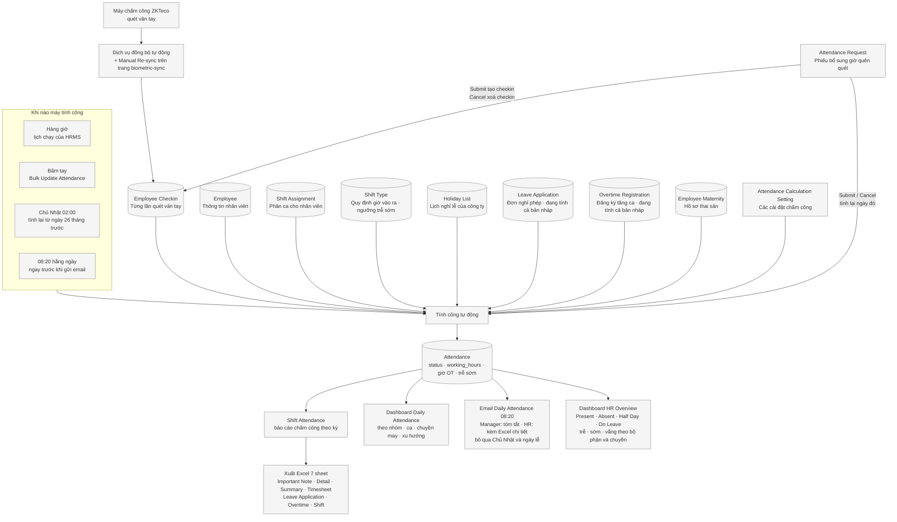

# Flowchart — Chấm công TIQN và các báo cáo đọc từ Attendance

> **Mục đích:** Sơ đồ **phản ánh hệ thống đang chạy thật**, không phải quy trình mong muốn.
> **Phạm vi:** Chấm công và báo cáo chấm công — **không** gồm phần lương (xem `payroll.md`)
> **Trạng thái:** Đang chạy · **Cập nhật:** 2026-10-21

Tên doctype, tên trường và các trạng thái giữ nguyên **tiếng Anh như HRMS hiển thị** — đúng chữ
HR nhìn thấy trên màn hình; phần giải thích bên dưới mỗi tên viết bằng tiếng Việt. Dòng
**Nguồn** ghi file và hàm trong mã nguồn để người lập trình kiểm lại khi sửa code, HR không cần
đọc dòng đó.

Xem sơ đồ: **`/dev-tool` → tab Flowchart**. Chi tiết bên trong khối *Tính công tự động* (các
nhánh `Present` / `Absent` / `Half Day` / `On Leave`, chốt giờ ngày có nghỉ phép) nằm ở sơ đồ 2
và 3 của `payroll.md`.

---

## 1. Toàn cảnh — từ lần quét vân tay đến báo cáo chấm công

> Nguồn: `api/biometric_resync.py` \(_add_checkin, resync_device_logs, resync_mongodb_logs\) · `overrides/attendance_request/attendance_request.py` \(CustomAttendanceRequest.on_submit, on_cancel, recalculate_attendance\) · `overrides/shift_type/__init__.py` \(patch process_auto_attendance_for_all_shifts\) · `overrides/shift_type/shift_type_optimized.py` \(bulk_update_attendance_optimized, preload_reference_data, weekly_recalculate_attendance_scheduled\) · `hooks.py` \(scheduler_events "20 8 \* \* \*", "0 \* \* \* \*"\) · `customize_erpnext/report/shift_attendance_customize/standard_export.py` \(ALL_SHEETS, build_standard_workbook\) · `customize_erpnext/report/ot_compliance/ot_compliance.py` · `api/daily_attendance_metrics.py` \(get_daily_metrics\) · `customize_erpnext/dashboard_chart_source/daily_attendance_*` · `api/daily_attendance_email.py` \(send_daily_attendance_email_scheduled\) · `customize_erpnext/number_card/hr_overview___*` · `customize_erpnext/dashboard_chart/hr_overview___*` · `employee_portal/attendance_data.py`

> **"Đang tính cả bản nháp"** là theo cài đặt hiện tại (kiểm 21/10/2026): `Attendance Calculation
> Setting` bật `include_draft_leave_application` và `include_draft_ot`, nên đơn nghỉ và đăng ký
> tăng ca **chưa duyệt** cũng được tính vào công. Tắt hai ô này thì máy chỉ lấy đơn đã submit.

> **Lịch Chủ Nhật 02:00** cũng là cài đặt (`auto_recalc_*`), đang bật đúng Chủ Nhật. Lịch chỉ
> chạy khi đã sang ngày 5 trở đi của tháng, để không tính lại kỳ công đã chốt.

---

## Bảng thuật ngữ — tên trong HRMS và nghĩa

| Tên trong hệ thống | Nghĩa |
|---|---|
| `Employee Checkin` | Từng lần quét vân tay ở máy chấm công |
| `Attendance Request` | Phiếu bổ sung giờ vào/ra khi quên quét, máy lỗi, ngày đầu đi làm |
| `Shift Type` / `Shift Assignment` | Khai báo ca (giờ vào ra, ngưỡng trễ sớm) / phân ca cho nhân viên theo ngày |
| `Holiday List` | Lịch nghỉ lễ, gán ở cấp Company |
| `Leave Application` | Đơn nghỉ phép |
| `Overtime Registration` | Đăng ký tăng ca |
| `Employee Maternity` | Hồ sơ thai sản — giai đoạn mang thai, nghỉ sinh, con nhỏ |
| `Attendance Calculation Setting` | Nơi bật tắt các cách tính công và lịch tính lại |
| `Attendance` | Bảng công — mỗi nhân viên một dòng cho một ngày |
| `status` | Trạng thái ngày công: `Present`, `Absent`, `Half Day`, `On Leave` |
| `working_hours` | Giờ công đã chốt (bị chặn theo đơn nghỉ) |
| `late_entry` / `early_exit` | Cờ đi trễ / về sớm |

## Chỗ cố ý không vẽ

- **Phần lương** (`Salary Slip`, `Salary Structure Assignment`, phiếu lương) — xem `payroll.md`.
- **Employee Leave Balance**: report số dư phép đọc sổ phép `Leave Ledger Entry`, **không** đọc
  `Attendance`, nên không phải báo cáo chấm công.
- **Ba report Overtime Registration** (theo khung giờ, theo số lượng…): đọc phiếu đăng ký tăng
  ca, **không** đọc `Attendance`.
- **Tính lại công khi sửa checkin / OT / thai sản**: có code nhưng đang **tắt** trong
  `Attendance Calculation Setting` (`recalc_attendance_on_checkin_change`,
  `recalc_attendance_on_ot_change`, `recalc_attendance_on_maternity_change` = 0). Thay đổi chỉ
  vào công ở lần tính công kế tiếp (hàng giờ, bấm tay, hoặc lịch Chủ Nhật).
- **Log ra/vào phòng IT** (`Door Access Log`): máy F21Lite riêng, không đi vào chấm công.
