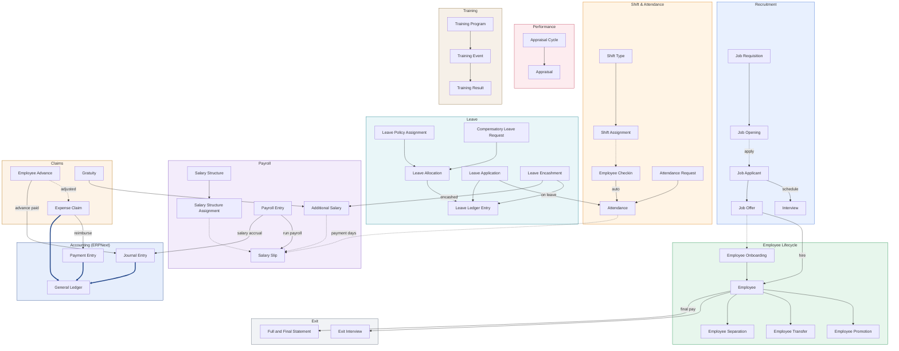

# HRMS v16 — how the HR system works

Sơ đồ: `hrms.drawio` — mở bằng [draw.io](https://app.diagrams.net) hoặc extension Draw.io Integration của VS Code. File để XML trần (không nén) nên git diff đọc được.

Sinh lại: `python3 scripts/build_hrms_flowchart.py`
Chỉ đối chiếu source, không ghi đè: `python3 scripts/build_hrms_flowchart.py --check`

> Script từ chối ghi đè nếu file .drawio đã được sửa tay. Muốn bỏ qua thì thêm `--force` (mất hết phần sửa tay).

## Sơ đồ

Bản mermaid của cùng sơ đồ, để tab Flowchart ở `/dev-tool` vẽ ngay trên trình duyệt. Bố cục do mermaid tự xếp; bản trình bày chuẩn vẫn là file `.drawio`.

## Ba loại mũi tên

- **Grey solid arrow — Creates the next document** (tạo chứng từ tiếp theo) — Press Create on the first document and HRMS opens the next one, already filled in. The two documents stay linked, so quantities and amounts are carried over and tracked.
- **Grey dashed arrow — Supplies data only** (chỉ lấy dữ liệu) — The document at the tip reads master data, a rule or a plan from the one at the tail. Nothing is created and nothing is posted.
- **Blue solid arrow — Posts to the General Ledger** (ghi vào sổ cái) — Submitting the document writes its accounting entries by itself. Cancel the document and the entries are reversed.

## Đối chiếu với source HRMS v16

Mỗi mũi tên dưới đây lấy từ source đang cài chứ không vẽ theo trí nhớ. Cột cuối là chỗ chứng minh, tính từ `hrms/hrms/`.

| Từ | Đến | Loại | Nghĩa | Bằng chứng |
| --- | --- | --- | --- | --- |
| Additional Salary | Salary Slip | chỉ lấy dữ liệu | Khoản cộng/trừ phát sinh được nhặt vào phiếu lương | `payroll/doctype/salary_slip/salary_slip.py:224` |
| Attendance | Salary Slip | chỉ lấy dữ liệu | Phiếu lương đếm ngày công từ Attendance (nếu cấu hình theo chấm công) | `payroll/doctype/salary_slip/salary_slip.py:511` |
| Employee Advance | Expense Claim | chỉ lấy dữ liệu | Hoàn ứng trừ vào khoản đã tạm ứng | `hr/doctype/expense_claim/expense_claim.py:626` |
| Job Offer | Employee Onboarding | chỉ lấy dữ liệu | Employee Onboarding trỏ về Job Offer | `hr/doctype/employee_onboarding/employee_onboarding.json:43` |
| Job Opening | Job Applicant | chỉ lấy dữ liệu | Job Applicant trỏ về Job Opening đang tuyển | `hr/doctype/job_applicant/job_applicant.json:78` |
| Salary Structure Assignment | Salary Slip | chỉ lấy dữ liệu | Phiếu lương lấy thang lương đang hiệu lực của nhân viên | `payroll/doctype/salary_slip/salary_slip.py:813` |
| Shift Assignment | Employee Checkin | chỉ lấy dữ liệu | Máy chấm công vào giờ nào thì tra ca đang gán để biết thuộc ca nào | `hr/doctype/employee_checkin/employee_checkin.py:12` |
| Appraisal Cycle | Appraisal | tạo chứng từ tiếp theo | Mở đợt đánh giá thì sinh phiếu đánh giá cho từng người | `hr/doctype/appraisal_cycle/appraisal_cycle.py:108` |
| Attendance Request | Attendance | tạo chứng từ tiếp theo | Attendance Request submit thì tạo Attendance | `hr/doctype/attendance_request/attendance_request.py:131` |
| Compensatory Leave Request | Leave Allocation | tạo chứng từ tiếp theo | Làm ngày nghỉ thì được cấp bù phép | `hr/doctype/compensatory_leave_request/compensatory_leave_request.py:93` |
| Employee | Employee Promotion | tạo chứng từ tiếp theo | Promotion submit thì cập nhật Employee | `hr/doctype/employee_promotion/employee_promotion.py:25` |
| Employee | Employee Transfer | tạo chứng từ tiếp theo | Transfer submit thì cập nhật Employee | `hr/doctype/employee_transfer/employee_transfer.py:22` |
| Employee | Employee Separation | tạo chứng từ tiếp theo | Employee Separation mở theo một nhân viên | `hr/doctype/employee_separation/employee_separation.json:33` |
| Employee | Exit Interview | tạo chứng từ tiếp theo | Mỗi nhân viên nghỉ việc chỉ một Exit Interview | `hr/doctype/exit_interview/exit_interview.py:29` |
| Employee | Full and Final Statement | tạo chứng từ tiếp theo | Full and Final Statement chốt các khoản phải trả / phải thu khi nghỉ | `hr/doctype/full_and_final_statement/full_and_final_statement.json:40` |
| Employee Advance | Journal Entry | tạo chứng từ tiếp theo | Chi tạm ứng ghi bằng Journal Entry | `hr/doctype/employee_advance/employee_advance.py:293` |
| Employee Checkin | Attendance | tạo chứng từ tiếp theo | Chạy auto attendance: dữ liệu quẹt thẻ sinh bản ghi Attendance | `hr/doctype/shift_type/shift_type.py:29` |
| Employee Onboarding | Employee | tạo chứng từ tiếp theo | Employee Onboarding > Create Employee | `hr/doctype/employee_onboarding/employee_onboarding.py:73` |
| Expense Claim | Payment Entry | tạo chứng từ tiếp theo | Expense Claim > Payment: trả tiền bằng Payment Entry | `hr/doctype/expense_claim/expense_claim.js:79` |
| Gratuity | Additional Salary | tạo chứng từ tiếp theo | Trợ cấp thôi việc trả qua Additional Salary | `payroll/doctype/gratuity/gratuity.py:108` |
| Job Applicant | Interview | tạo chứng từ tiếp theo | Job Applicant > Schedule Interview | `hr/doctype/job_applicant/job_applicant.py:133` |
| Job Applicant | Job Offer | tạo chứng từ tiếp theo | Job Applicant > Create Job Offer | `hr/doctype/job_applicant/job_applicant.js:87` |
| Job Offer | Employee | tạo chứng từ tiếp theo | Job Offer > Create Employee | `hr/doctype/job_offer/job_offer.py:97` |
| Job Requisition | Job Opening | tạo chứng từ tiếp theo | Job Requisition > Create > Job Opening | `hr/doctype/job_requisition/job_requisition.py:47` |
| Leave Allocation | Leave Ledger Entry | tạo chứng từ tiếp theo | Mỗi lần cấp phép ghi một dòng sổ phép | `hr/doctype/leave_allocation/leave_allocation.py:302` |
| Leave Application | Attendance | tạo chứng từ tiếp theo | Đơn nghỉ duyệt xong đánh dấu Attendance là On Leave | `hr/doctype/leave_application/leave_application.py:284` |
| Leave Application | Leave Ledger Entry | tạo chứng từ tiếp theo | Đơn nghỉ trừ phép qua sổ phép | `hr/doctype/leave_application/leave_application.py:30` |
| Leave Encashment | Leave Ledger Entry | tạo chứng từ tiếp theo | Bán phép thì trừ số ngày trong sổ phép | `hr/doctype/leave_encashment/leave_encashment.py:14` |
| Leave Encashment | Additional Salary | tạo chứng từ tiếp theo | Tiền bán phép đi vào lương qua Additional Salary | `hr/doctype/leave_encashment/leave_encashment.py:156` |
| Leave Policy Assignment | Leave Allocation | tạo chứng từ tiếp theo | Gán chính sách nghỉ thì cấp phép cho cả kỳ | `hr/doctype/leave_policy_assignment/leave_policy_assignment.py:114` |
| Payroll Entry | Salary Slip | tạo chứng từ tiếp theo | Payroll Entry tạo phiếu lương hàng loạt | `payroll/doctype/payroll_entry/payroll_entry.py:265` |
| Payroll Entry | Journal Entry | tạo chứng từ tiếp theo | Payroll Entry hạch toán chi phí lương bằng Journal Entry | `payroll/doctype/payroll_entry/payroll_entry.py:563` |
| Salary Structure | Salary Structure Assignment | tạo chứng từ tiếp theo | Gán thang lương cho từng nhân viên | `payroll/doctype/salary_structure/salary_structure.py:276` |
| Shift Type | Shift Assignment | tạo chứng từ tiếp theo | Shift Assignment gán một Shift Type cho nhân viên | `hr/doctype/shift_assignment/shift_assignment.json:59` |
| Training Event | Training Result | tạo chứng từ tiếp theo | Training Event > Training Result: chấm kết quả sau buổi học | `hr/doctype/training_event/training_event.js:10` |
| Training Program | Training Event | tạo chứng từ tiếp theo | Buổi đào tạo thuộc một chương trình | `hr/doctype/training_event/training_event.json:52` |
| Expense Claim | General Ledger | ghi vào sổ cái | Expense Claim submit thì ghi sổ cái | `hr/doctype/expense_claim/expense_claim.py:148` |
| Journal Entry | General Ledger | ghi vào sổ cái | Journal Entry submit thì ghi sổ cái | `../../erpnext/erpnext/accounts/doctype/journal_entry/journal_entry.py:208` |
| Payment Entry | General Ledger | ghi vào sổ cái | Payment Entry submit thì ghi sổ cái | `../../erpnext/erpnext/accounts/doctype/payment_entry/payment_entry.py:35` |

## Những chỗ cố ý đặt khác module thật

- **Journal Entry / Payment Entry / General Ledger** là của ERPNext, không phải HRMS. Vẽ vào đây để thấy tiền lương và tạm ứng đi đâu.
- **Employee** là DocType của ERPNext (module Setup), không phải của HRMS — HRMS chỉ thêm field vào. Vẫn vẽ như trung tâm vì mọi chứng từ nhân sự trỏ về nó.
- **Gratuity** thuộc module Payroll, nhưng xếp chung khung Claims vì nó cũng là một khoản trả cho nhân viên.

## Có trong v16 nhưng cố ý không vẽ

Sơ đồ dành cho người quản lý nhìn tổng thể, nên các nhánh phụ sau bị lược bỏ:

- Staffing Plan giới hạn số lượng tuyển của Job Opening — `hr/doctype/job_opening/job_opening.py::validate_current_vacancies`
- Appointment Letter in từ Job Applicant — `hr/doctype/appointment_letter`
- Employee Referral → Job Applicant — `hr/doctype/employee_referral`
- Shift Request → Shift Assignment, Shift Schedule Assignment — `hr/doctype/shift_request/shift_request.py`
- Leave Control Panel cấp phép hàng loạt, Leave Adjustment, Leave Block List — `hr/doctype/leave_control_panel`
- Employee Benefit Application / Claim, Employee Tax Exemption Declaration → Proof Submission — `payroll/doctype/employee_tax_exemption_declaration`
- Payroll Entry → Payment Entry (chi lương), Salary Withholding, Payroll Correction — `payroll/doctype/payroll_entry/payroll_entry.py::make_payment_entry`
- Employee Grievance, Daily Work Summary, Vehicle Log, Travel Request — `hr/doctype`
- Toàn bộ phần custom của TIQN (chấm công tối ưu, đăng ký tăng ca, đồng phục, khám sức khoẻ) — `apps/customize_erpnext — xem docs/mindmap/hr_mindmap.md`
